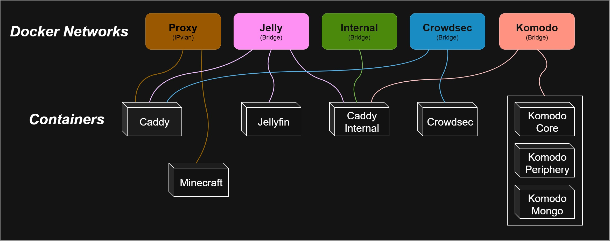

# Docker

This is where my homelab started, and until I am fully comfortable with Kubernetes the services my users and I use everyday will continue to run here.

 

# Architecture

Everything runs in a single docker environment via Docker Compose.  Containers are segregated via docker networking as shown below.

 

# Containers

Each service has its own folder where the associated compose file lives.

## Caddy

This is the external-facing reverse proxy.  It is running a custom caddy docker image that implements various features that are helpful for handling requests from the open internet.

### Networking

The docker network mode on this container is IPvlan.  This allows the container to receive a dedicated IP on my local network separate from the physical docker host.  It's not absolutely necessary but it does make creating and tracking DNS entries easier as public requests come in and get routed to only the exposed Caddy container IP.  Looking at my DNS entries I can easily tell which ones are routing to the exposed Caddy container, and incoming requests from the public internet are kept separate from my docker host's primary IP.

This IPvlan proxy network is only connected to services I'm comfortable exposing to the internet, and each has a corresponding route definition within the Caddyfile.

Routing within docker networking is also nice because you can define endpoints via container name.  Docker networking will check its local DNS first and route to the appropriate container just based off name & port like `jellyfin:8096`, which keeps the DNS entries on your firewall from getting cluttered.

## Caddyint

This is a second caddy instance for internal services.  Two caddy containers, one for public access and one for internal access, is a security decision and keeps services segregated.  People coming in from the internet via my open port access the public caddy, which isn't connected to and doesn't have a route for any of the internal services because those are all on the internal caddy.  Therefore, there's very little chance a manipulation could occur to allow an external visitor to reach a service I don't want them to.

## Crowdsec

Crowdsec is a community-driven security platform that aggregates security data from its users to continually update and strengthen the platform.

I have Crowdsec set up to monitor the logs from the public caddy and Jellyfin containers.  It monitors for nefarious requests to caddy like network scans and temporarily bans the source IPs.  It also looks at the Jellyfin logs for any brute-force attempts and will ban those IPs as well. 

## Jellyfin

Standard Jellyfin setup.  All media is hosted on the NAS and get delivered via bonded 10Gb links.  Intel Arc GPU is passed through to the container for extra transcoding horsepower.

## Komodo

I'm testing out this container management platform right now.  I used to run Portainer.

## Minecraft

Modded Minecraft server.  I do publicly expose this when my friends and I get the Minecraft itch, which is usually a few weeks per year. 