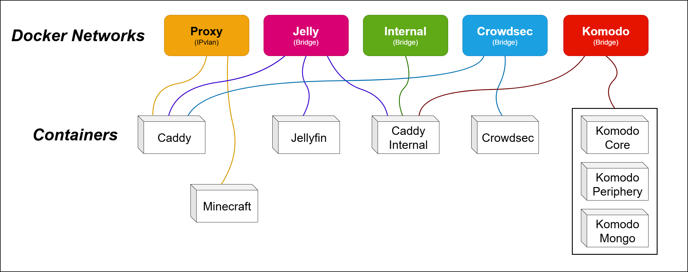

# Docker

This is where my homelab started, and until I am fully comfortable with Kubernetes the services my users and I use everyday will continue to run here.

 

# Architecture

Everything runs in a single docker environment via Docker Compose.  Containers are segregated via docker networking as shown below.

 

# Containers

Each service has its own folder where the associated compose file lives.

## Caddy

This is the external-facing reverse proxy.  It is running a custom caddy docker image that implements various features that are helpful for handling requests from the open internet.

## Caddyint

## Crowdsec

## Jellyfin

## Komodo

## Minecraft